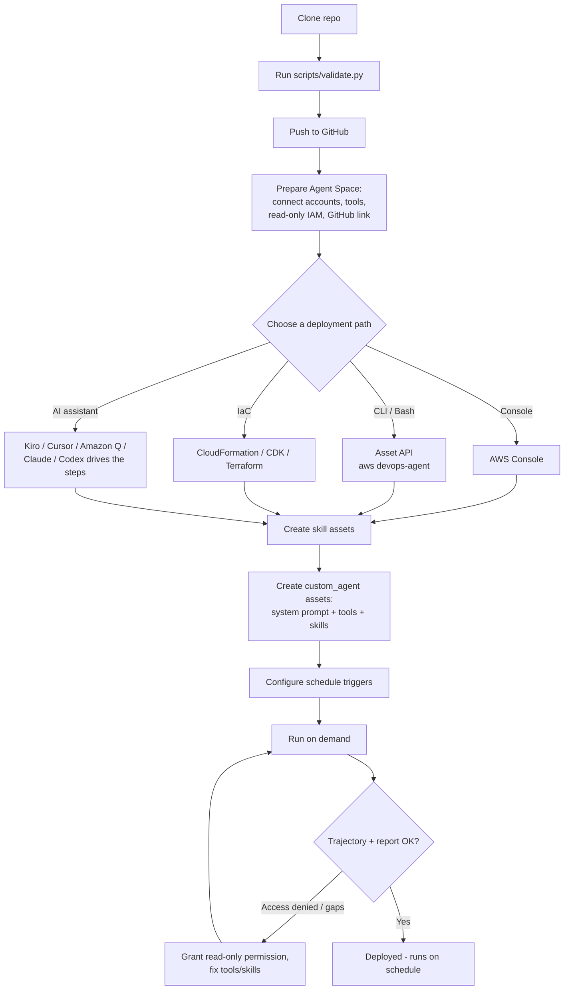

# AWS DevOps Agent - Sample Custom Agents and Skills

A curated, ready-to-deploy collection of **227 custom agents** and **145 skills** for
[AWS DevOps Agent](https://docs.aws.amazon.com/devopsagent/latest/userguide/working-with-devops-agent-custom-agents-index.html).

Every agent is read-only and produces an operational report or recommendation:
health summaries, cost and compliance audits, trend analyses, and multi-step
operational workflows across AWS, CloudWatch, and CI/CD data. Every skill packages
an investigation procedure or decision framework the agent loads automatically
when a task matches.

- **Agents** live under [`agents/`](agents/), one directory per agent, each with a
  `system-prompt.md` (the agent's instructions) and an `agent-config.json`
  (its recommended tools, skills, and schedule trigger).
- **Skills** live under [`skills/`](skills/), grouped into 19 operational domains,
  each with a `SKILL.md` containing `name`, `description`, and `agent_type`
  frontmatter plus the procedure itself.

---

## How this maps to AWS DevOps Agent

A custom agent in AWS DevOps Agent is a **system prompt** plus a selected set of
**MCP tools**, optional **skills**, optional **memory stores**, and an optional
**schedule trigger**. Understanding how the service consumes these files avoids
the most common deployment surprise:

- **Agent import reads only the system prompt.** When you import an agent from
  GitHub, the service ingests a single `.md` file as the system prompt. It does
  **not** read `agent-config.json`. The tools, skills, and trigger in that file
  are recommendations you apply separately through Chat or the Asset API.
- **Skill import reads the whole skill directory.** The service reads the
  `SKILL.md` frontmatter (`name`, `description`) to decide when to activate the
  skill and imports the directory contents. The `agent_type` frontmatter in each
  skill records which agent type it targets (Generic, Incident RCA, Evaluation,
  and so on).
- **Tools are assigned only through Chat or the Asset API**, never from a file.

To bridge the gap between `agent-config.json` and the import flow, this repo
ships a generator that turns each config into a copy-paste Chat command
(see [Deploying](#deploying)).

---

## Repository layout

```
agents/                 261 custom agents (system-prompt.md + agent-config.json)
skills/                 169 skills across 24 domains (SKILL.md per skill)
deploy/                 Deployment options: Console, AWS CLI, Bash, CloudFormation, CDK, Terraform
agent-actions/          Optional directed actions: turn recommendations into approved changes
policies/               Least-privilege read-only IAM starting policy
schemas/                JSON schema for optional machine-readable recommendations
scripts/                validate.py and generate_deploy_commands.py
AGENT_TEMPLATE.md       Authoring template and best-practices checklist
CATALOG.md              Browse agents and skills by operational domain and by AWS service
DEPLOYMENT.md           Step-by-step deployment guide (Console-focused)
SECURITY.md             Security and guardrails framework
```

---

## Quick start

1. **Validate the collection** (run this before deploying or after any edit):

   ```bash
   python scripts/validate.py
   ```

   It checks that every file is pure ASCII, every `agent-config.json` is valid
   and uses only known DevOps Agent tools, every system prompt has the required
   sections in order, and every `SKILL.md` has valid `name`, `description`, and
   `agent_type` frontmatter.

2. **Generate Chat deploy commands** for the agents you want:

   ```bash
   python scripts/generate_deploy_commands.py            # all agents
   python scripts/generate_deploy_commands.py 01 02      # by agent number
   python scripts/generate_deploy_commands.py cost       # by name fragment
   python scripts/generate_deploy_commands.py --out deploy.txt
   ```

   Each block is ready to paste into DevOps Agent Chat to create the agent,
   assign its tools and skills, and set its trigger.

3. **Deploy.** Import skills from this repository, then create agents and assign
   their tools. See [DEPLOYMENT.md](DEPLOYMENT.md) for the full walkthrough.

---

## Deploying

The workflow is the same regardless of which method you pick: get the repo onto
GitHub and validate it, prepare the Agent Space, then create the two asset types
(skills and custom agents), wire up triggers, and verify a run.



Notes reflected in the diagram: skills are created before agents (an agent
references its skills by name); agent import reads only the system prompt, so
tools and triggers are applied separately (the Asset API and IaC paths apply
them together); and triggers are set in the Console or via the CloudFormation
`AWS::DevOpsAgent::Trigger` resource, not through the Asset API.

For a clean, ordered walkthrough from clone to a running agent, start with
[deploy/QUICKSTART.md](deploy/QUICKSTART.md). Otherwise choose the option that
matches how you work. Each has a guide under [deploy/](deploy/):

| Option | Guide | Best for |
|--------|-------|----------|
| AWS Console | [deploy/console/](deploy/console/) | First-time setup, guided tool assignment |
| AWS CLI | [deploy/aws-cli/](deploy/aws-cli/) | Scripted one-off creates via the Asset API |
| Bash | [deploy/bash/](deploy/bash/) | End-to-end bulk deploy from the terminal |
| CloudFormation | [deploy/cloudformation/](deploy/cloudformation/) | Declarative IaC and pipelines (also creates triggers) |
| CDK | [deploy/cdk/](deploy/cdk/) | IaC in TypeScript, generated from the repo files |
| Terraform | [deploy/terraform/](deploy/terraform/) | IaC for Terraform-standardized teams |
| AI assistants | [deploy/ai-assistants/](deploy/ai-assistants/) | Kiro, Cursor, Amazon Q, Claude, or Codex driving the deploy, or reusing the skills inside those tools |

See [deploy/README.md](deploy/README.md) for how the options compare and the
asset model they share. Full Console instructions, including bulk deployment and
a suggested rollout order, are in [DEPLOYMENT.md](DEPLOYMENT.md). In short:

**Skills** - import from GitHub (recommended, enables sync), upload as ZIP, or
create in the UI. For GitHub import, paste the skill directory URL into
**Knowledge > Skills > Add skill > Import from repository**, for example:

```
https://github.com/YOUR-ORG/YOUR-REPO/tree/main/skills/incident-management/blast-radius-assessment
```

**Agents** - create through Chat (recommended, because tools are only assignable
in Chat) using the blocks from `generate_deploy_commands.py`, or import the
`system-prompt.md` from GitHub and then assign tools in Chat afterwards.

Because agent import reads only the system prompt, the tools and trigger from
`agent-config.json` must be applied separately. The generator script produces
exactly the Chat instructions to do that.

---

## How an agent uses the right skill

An agent does not follow a fixed agent-to-skill mapping. Whether a skill is used
depends on two independent gates, and both must pass:

1. **The skill must be reachable by the agent.** A custom agent loads only the
   skills you assign to it, plus any skill whose `agent_type` is `Generic`
   (available to all agent types). If a skill is neither assigned nor `Generic`,
   the agent can never load it. This is why each generated deploy block includes
   an "Assign these skills" line and why every `SKILL.md` records its
   `agent_type`.

2. **The agent must judge the skill relevant at runtime.** During an invocation
   the agent reads the `description` frontmatter of each reachable skill and
   decides, per task, whether that skill applies. There is no keyword table - the
   description is the trigger. Per AWS guidance, a vague or missing description
   causes the agent to skip the skill even when its instructions are good.

To make activation reliable:

- **Assign the intended skills.** Use the "Assign these skills" line from
  `generate_deploy_commands.py`, or assign them in Chat, for example:

  ```
  Assign the blast-radius-assessment and metric-correlation-investigator skills
  to my incident-postmortem-generator agent.
  ```

- **Keep descriptions specific and trigger-oriented.** Write them from the
  agent's perspective, naming the services, symptoms, and scenarios that should
  activate the skill (the skills in this repo already follow this style). If you
  edit a skill's `description`, re-import or sync it so the service picks up the
  change.

- **Assign only relevant skills.** You can attach up to 200 skills per agent, but
  a focused set reduces context consumption and improves activation accuracy.

### Confirm a skill actually fired

After deploying, run the agent on demand and open its **invocation trajectory**.
The trajectory shows which skills the agent loaded and when. If an expected skill
did not activate, it is almost always one of the two gates above: the skill was
not assigned (or not `Generic`), or its `description` did not clearly match the
task. See [DEPLOYMENT.md](DEPLOYMENT.md#verifying-deployment) for the full
verification steps and the recommended agent-to-skill pairings.

---

## Prerequisites

- An AWS DevOps Agent **Agent Space** with at least one connected integration and
  the AWS accounts you want to analyze connected to it.
- The MCP tools the agents use available in your Agent Space: `use_aws`,
  `query_cloudwatch_metrics`, `query_cloudwatch_logs`, `list_cloudwatch_alarms`,
  `list_investigations`, and `use_kubectl` (EKS agents only).
- Read-only IAM permissions on the analyzed services. A scoped starting policy is
  provided at [policies/agent-readonly-policy.json](policies/agent-readonly-policy.json).
- A connected **GitHub account** to import agents and skills directly from a
  repository.

See [DEPLOYMENT.md](DEPLOYMENT.md#prerequisites) for details.

---

## Safety model

Every agent in this repository is **read-only**: it never creates, modifies, or
deletes resources, and it never recommends a prohibited action. Findings are
grounded in observed values, interpretations are labeled as hypotheses, and
sensitive data is referenced by identifier rather than reproduced. Agents may
optionally emit machine-readable recommendation records conforming to
[schemas/recommendation.schema.json](schemas/recommendation.schema.json) for a
human-approval workflow; emitting a record never executes anything. See
[SECURITY.md](SECURITY.md) and [AGENT_TEMPLATE.md](AGENT_TEMPLATE.md).

To go beyond recommendations and let AWS DevOps Agent implement an approved fix
through a directed action, see [agent-actions/](agent-actions/). Directed actions
are opt-in and disabled by default: they require enabling directed actions on the
agent space, registering a scoped elevated IAM role, and per-action operator
approval in chat. That folder maps each read-only finding to the specific
mutating operation that remediates it, and marks which fixes the agent refuses
outright (delete-class operations, anything needing `iam:PassRole`, and the
repository's prohibited actions), so those stay manual. Enabling directed actions
is a deliberate change to your operating posture; the default remains read-only.

---

## Browsing and authoring

- To find an agent or skill by operational domain or by AWS service, see
  [CATALOG.md](CATALOG.md).
- To author a new agent or skill that matches the repository conventions, follow
  [AGENT_TEMPLATE.md](AGENT_TEMPLATE.md) and the skills library overview in
  [skills/README.md](skills/README.md), then run `python scripts/validate.py`.

---

## Contributing

Contributions are welcome. Before opening a merge request, run
`python scripts/validate.py` and confirm it passes. See
[CONTRIBUTING.md](CONTRIBUTING.md) and [CODE_OF_CONDUCT.md](CODE_OF_CONDUCT.md).

## License

See [LICENSE](LICENSE).

## References

- [AWS DevOps Agent User Guide](https://docs.aws.amazon.com/devopsagent/latest/userguide/)
- [Custom Agents](https://docs.aws.amazon.com/devopsagent/latest/userguide/working-with-devops-agent-custom-agents-index.html)
- [Creating a custom agent](https://docs.aws.amazon.com/devopsagent/latest/userguide/custom-agents-creating-a-custom-agent.html)
- [DevOps Agent Skills](https://docs.aws.amazon.com/devopsagent/latest/userguide/about-aws-devops-agent-devops-agent-skills.html)
- [Managing assets (API)](https://docs.aws.amazon.com/devopsagent/latest/userguide/about-aws-devops-agent-managing-assets.html)
