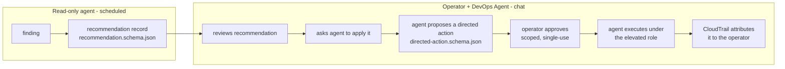
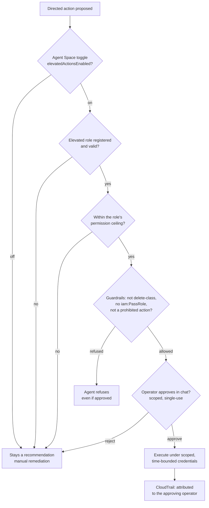

# Agent Actions - directed actions for remediation

The agents and skills in this repository are read-only by default. They produce
findings and recommendations; a human then acts. This folder documents how to
let AWS DevOps Agent go one step further and **implement** an approved
recommendation through a directed action, and it maps the read-only findings the
existing agents produce to the specific directed action that remediates each one.

This is an opt-in, human-in-the-loop capability. Nothing here changes the default
posture of the collection: agents remain read-only unless you deliberately enable
directed actions and register an elevated role. See
[../SECURITY.md](../SECURITY.md).

Reference: [Working with directed actions](https://docs.aws.amazon.com/devopsagent/latest/userguide/working-with-devops-agent-working-with-directed-actions.html).

---

## Read-only actions vs directed actions

AWS DevOps Agent distinguishes two kinds of operations:

- **Read-only actions** - operations that only read (describe, get, list, and
  CloudWatch reads). Available by default. This is everything the agents in this
  repository do today.
- **Directed actions** - operations that create or modify resources. Disabled by
  default. Elevated, layered opt-in, and per-action operator approval at
  execution time. This is how a recommendation becomes an applied change.

A directed action is not a different tool. The agent uses the same `use_aws`
tool; what makes an operation a directed action is that it **mutates** a resource
(for example `ec2:RevokeSecurityGroupIngress` instead of
`ec2:DescribeSecurityGroups`).

---

## The safety model (defense in depth)

Directed actions are gated by independent layers. All must be satisfied before a
change is applied:

1. **Agent-space toggle.** Directed actions are enabled on the agent space
   (`elevatedActionsEnabled=true`). If disabled, every layer below is inert.
2. **Registered elevated role.** Per AWS account, you register an IAM role
   (`agentElevatedRoleArn`) that the agent assumes. The role's permission policy
   is the **ceiling** of what the agent can ever do in that account. It is not a
   standing grant. See [iam/](iam/).
3. **Per-action operator approval.** Every directed action pauses for a human to
   approve in chat. The approval names the exact operation, resource, and
   parameters, and the operator can narrow (never widen) them or reject.
4. **Session-scoped credentials.** On approval, the agent gets credentials scoped
   to that one operation and resource, valid for a bounded window. An approval
   cannot be reused for a different operation or resource.
5. **CloudTrail attribution.** The call carries a source identity attributing it
   to the approving operator. Every directed action is auditable back to the
   human who approved it.

Approvals are surfaced only in chat. A mutating operation attempted outside chat
(for example during an autonomous scheduled run) **fails** rather than executing.
This is why the scheduled agents in this repository stay read-only: they cannot
obtain approval, so they propose rather than act.

---

## Guardrails the agent enforces regardless of permissions

Independent of what the elevated role's policy allows and independent of operator
approval, the agent refuses these classes of operation against AWS resources.
Approval does not override them:

- **Delete-class operations.** The agent will not delete an instance, bucket,
  table, function, stack, or similar. A human deletes resources with their own
  credentials.
- **Permissions-boundary mutation.** The agent will not call
  `iam:PutRolePermissionsBoundary`, `iam:DeleteRolePermissionsBoundary`,
  `iam:PutUserPermissionsBoundary`, or `iam:DeleteUserPermissionsBoundary`.
  Boundaries are a control you use to constrain the agent.
- **Operations that require `iam:PassRole`.** By default the agent does not
  perform operations that pass a role to a service (for example launching an
  instance with an instance profile, creating a Lambda with an execution role, or
  starting a task with a task role).

These service-side guardrails are additional to this repository's own
[prohibited actions](../SECURITY.md#prohibited-recommendations-global) (no
wildcard IAM, no disabling Block Public Access, no `0.0.0.0/0` inbound, no
disabling logging or encryption, and so on). The prohibited actions are things
the agents will never even recommend; the guardrails above are things the service
will refuse to execute even if recommended and approved. A safe directed action
must pass both.

Third-party and MCP tools use a classification model instead:
`READ_ONLY` (runs freely), `MUTATIVE` (needs directed actions plus approval), and
`DESTRUCTIVE` (never invoked).

---

## How this repository fits together

The safety model is defense in depth: every layer below must pass before a change
is applied, and the agent refuses destructive operations even with approval.

- A read-only agent emits a **recommendation record**
  ([../schemas/recommendation.schema.json](../schemas/recommendation.schema.json)).
- To apply it, an operator asks DevOps Agent in chat to carry out the step. The
  agent turns it into a proposed **directed action**
  ([directed-action.schema.json](directed-action.schema.json)), requests approval,
  and executes under the elevated role.

The mappings in [mappings/](mappings/) connect the read-only findings the agents
in this repository produce to the specific directed action that remediates each
one, including which findings can be auto-remediated, which require narrowing,
and which the agent refuses (so remediation stays manual).

---

## Contents

- [iam/](iam/) - the elevated-role trust policy and a scoped least-privilege
  ceiling policy, plus notes on the AWS managed policy.
- [directed-action.schema.json](directed-action.schema.json) - the shape of an
  approvable directed action derived from a recommendation.
- [mappings/](mappings/) - read-only finding to directed action, per domain.

---

## Enabling directed actions (summary)

1. Enable directed actions on the agent space
   (console toggle, or `aws devops-agent update-agent-space --preferences elevatedActionsEnabled=true`).
2. Create the elevated role in each target account with the trust policy in
   [iam/elevated-role-trust-policy.json](iam/elevated-role-trust-policy.json) and
   a permission ceiling (managed policy or the scoped example in
   [iam/elevated-role-permission-policy.json](iam/elevated-role-permission-policy.json)).
3. Register the role on the association (`agentElevatedRoleArn`) and confirm its
   status is `valid`.
4. For third-party/MCP tools, classify mutating tools and opt them in.
5. Operators approve each directed action in chat.

Full, current steps are in the AWS documentation linked above. Treat directed
actions as a deliberate, reviewed change to your operating posture.
